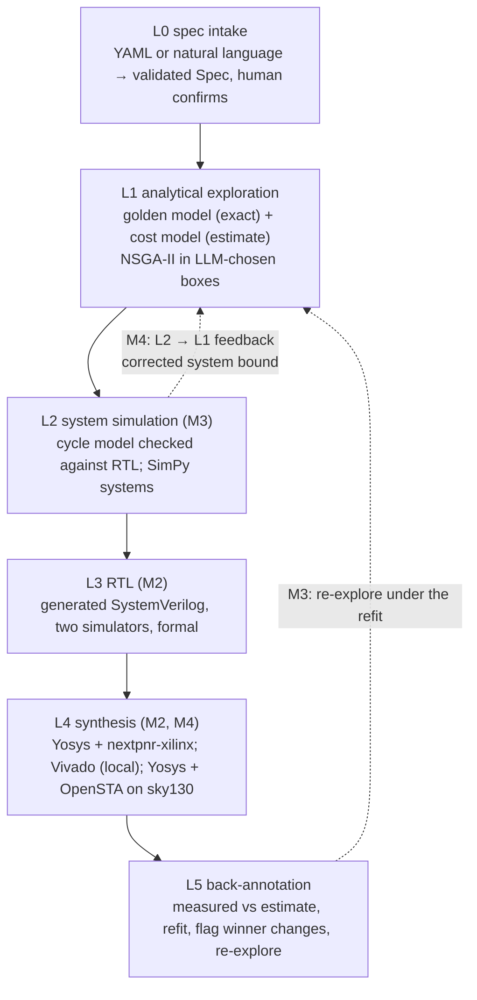

# HW Design Space Agent: final technical report (M1–M4)

This is the project's closing report. It is built from the data committed in this
repository. Every number below is a named fact that `scripts/writeup_facts.py` computes from
the committed data or reads from one named cell of a generated report
(`docs/writeup_facts.json`); each section names, in a comment under its heading, the fact
behind each of its numbers in reading order, and `tests/test_writeup.py` checks every printed
number against its fact at the printed precision. Where a section reports a loss, the loss
comes first.

## The question

<!-- facts: grid_designs budget_evals -->

Can a language model make hardware design-space exploration better, if it is never allowed to
produce a number? The running problem is a CORDIC sin/cos unit with four architecture families
(`iterative`, `unrolled_k`, `pipelined`, `pipelined_m`) and numeric knobs (data width,
iterations, angle-path width, guard bits, rounding, and the unroll or pipelining factor):
635,040 designs, small enough to enumerate, so every method can be scored against the exact
answer. A spec gives constraints (throughput, accuracy, from M3 system timing), one to three
objectives, a selection rule and a budget of 400 evaluations.

The rule held from the first commit to the last: **the LLM is never the optimiser and never
produces a PPA, accuracy or system-level number.** It plays the architect: it reads the spec,
picks families and ranges from a fixed registry, reads code-written summaries, and takes one
of a few typed decisions (refine, widen, add a family, map the front, declare infeasible,
stop). Optuna's NSGA-II searches inside its boxes; a bit-accurate golden model gives exact
accuracy; cost models give estimates; synthesis gives measurements; simulation gives system
metrics. Every number carries its provenance: *exact*, *estimate*, *measured (tool, version)*
or *simulated (model, version)*. The structured-output schemas have no field where a number
about a design could go.

Two scores recur. **HV fraction**: the hypervolume of the feasible designs a run found over
the true hypervolume of the exhaustive grid. **Selection regret**: how much worse the design
the run finally selects is than the true optimum on the spec's selection metric. Baselines are
NSGA-II and random search over the whole space with the same budget and the same evaluation
function.

## The ladder

<!-- facts: golden_exhaustive_angles l3_rtl_configurations l3_rtl_runs l3_rtl_mismatches
     l3_gate_runs l3_gate_mismatches formal_pass formal_jobs l4_points vivado_designs
     asic_calibration_points asic_validation_points -->

Each rung is code; the LLM sits only in the L1 loop. The ladder was built bottom-up in
evidence: the golden model is bit-exact against the reference RTL on all 65,536 input angles
of the reference configuration; the generated RTL matched the golden model in
47 configurations across two simulators (94 runs, 0 mismatches) and at gate level
(22 runs, 0 mismatches), with 7 of 7 formal proofs; L4 has 39 open-source FPGA points,
14 Vivado designs and, in M4, 57 ASIC calibration points plus 9 held-out ones.

## Milestone 1: the architect is a good selector and a bad mapper

<!-- facts: m1.hv_rel.dds_250msps.sonnet m1.hv_rel.dds_250msps.deepseek
     m1.hv_rel.dds_250msps.qwen m1.hv_rel.low_area_control.sonnet
     m1.hv_rel.low_area_control.deepseek m1.hv_rel.low_area_control.qwen m1.hv_gain_rule_pct
     m1.regret.low_area_control.qwen m1.regret.low_area_control.nsga2 infeasible.rate_msps
     m1.infeasible_evals_min m1.infeasible_evals_max budget_evals -->

**Loss first.** The M1 agent mapped the Pareto front far worse than plain NSGA-II on two of
three feasible specs: its HV fraction relative to NSGA-II was 0.32, 0.87 and 0.46 on
`dds_250msps` and 0.23, 0.22 and 0.18 on `low_area_control` for Sonnet 5.5, DeepSeek V4.1 Flash
and Qwen3.8-27B (reasoning off). It dived at the corner the selection rule picks and the 1%
hypervolume-gain rule then stopped it with a narrow front.

**What worked.** It selected better. Mean selection regret was below NSGA-II's on every model
and spec except one (Qwen on `low_area_control`, +12.2% against NSGA-II's +8.0%), and every
model declared the infeasible 400 MSPS spec infeasible itself in every run, using 100–200
evaluations where the baselines spend all 400 and simply find nothing. The cost model behind
all of this was weak by construction: five constants solved from two Vivado anchors.

## Milestone 2: climbing the ladder, and fixing the mapper in code

<!-- facts: m2.coverage_reserve_pct m2.hv_rel.dds_250msps.sonnet m2.hv_rel.dds_250msps.deepseek
     m2.hv_rel.dds_250msps.qwen m2.hv_rel.low_area_control.sonnet
     m2.hv_rel.low_area_control.deepseek m2.hv_rel.low_area_control.qwen
     m2.hv_rel.high_precision.sonnet m2.hv_rel.high_precision.deepseek
     m2.hv_rel.high_precision.qwen m2.regret.dds.deepseek.m1 m2.regret.dds.deepseek.m2
     m2.regret.low_area.deepseek.m1 m2.regret.low_area.deepseek.m2
     m2.regret.high_precision.qwen m2.regret.high_precision.qwen_std yosys_fpga_version
     vivado_version vivado_designs m2.viv_pipelined_fmax_low_min m2.viv_pipelined_fmax_low_max
     m2.viv_iterative_fmax_high_min m2.viv_iterative_fmax_high_max m2.viv_unrolled_luts_low_min
     m2.viv_unrolled_luts_low_max m2.viv_unrolled_k_lo m2.viv_unrolled_k_hi m2.refit_points -->

**The levers.** M2 added deterministic whole-curve levers: a 40% reserve the LLM's own rounds
may not spend once something is feasible, a front-mapping round that code runs with whatever
is left, and a `map_front` decision the LLM may choose. They were tuned offline by replaying
the recorded M1 decisions, without spending anything. Live, the front-mapping gap closed:
agent HV relative to NSGA-II went to 1.02, 1.08 and 1.09 on `dds_250msps`, 0.97, 1.02 and
0.99 on `low_area_control` and 1.04, 1.05 and 0.96 on `high_precision`.

**Losses.** The selection lead mostly survived but not everywhere: DeepSeek's regret rose on
`dds_250msps` (+2.2% to +7.6%) and `low_area_control` (+1.6% to +5.1%), and Qwen on
`high_precision` reached +17.5% ± 27.2 on the strength of one seed whose first box was too
narrow to reach the accuracy target; the front-mapping round then never revisited that family.

**The measurements.** The open-source flow (Yosys 0.68 + nextpnr-xilinx on the anchors' part)
and, later, Vivado 2025.2 on 14 generated designs showed what the two-anchor model gets wrong.
Its known biases against Vivado are `pipelined` Fmax low by 15–17%, `iterative` Fmax high by
14–16%, and `unrolled_k` LUTs low by 37–40% at k = 3–4. A refit on 51 points was no better on
unseen Vivado points than the untouched M1 model, so the default never changed, and no spec's
ground-truth winner moved under the refit.

## Milestone 3: the design in a system, and an LLM outer loop that gained nothing

<!-- facts: m3.l2_traces_identical m3.l2_traces m3.l2_clock_edges m3.multiaxis.l1_bound_feasible
     m3.multiaxis.sim_feasible m3.l2_reselect_structured m3.structured_runs
     m3.l2_reselect_campaign m3.campaigns m3.campaigns_single_run_dse_400 m3.campaigns
     budget_evals m3.campaign_cost_ratio.qwen m3.campaign_cost_ratio.deepseek
     m3.campaign_cost_ratio.sonnet m3.qwen_campaign_failed m3.qwen_campaigns -->

**L2.** A cycle-accurate model of each family's interface contract matched the generated RTL
on 48/48 bursty traces (28,424 clock edges). SimPy models put the unit in a DDS, a control loop
and a bursty stream. On `multiaxis_control` only the simulation finds the winner: 53,667
designs pass the L1 bound, 51,244 the simulation, and the bound's winner misses the batch
deadline. On `bursty_offload` a peak-rate floor would have done as well, and the DDS spec
reduced to the throughput-only view. In the live runs L2 changed the L1 selection in 0 of 30
structured runs and in 4 of 65 campaign runs, all on `multiaxis_control`.

**The campaign agent (loss).** An outer agent on LangChain Deep Agents could call the
structured graph, single NSGA-II studies, the L2–L5 rungs and a memory. In 52 of 65 campaigns
its plan came down to one 400-evaluation call to the structured graph, and it cost 1.44 (Qwen),
1.62 (DeepSeek) and 2.25 (Sonnet) times as much per spec. Qwen failed 4 of 30 campaigns by
looping on the ladder tools. Its free-text notes to the inner architect narrowed the first box
in the worst run. Memory on vs off showed no benefit at three seeds. The campaign layer stayed
experimental and off by default.

## Milestone 4: a second target, a fleet, and feedback from L2 to L1

### An ASIC target on sky130

<!-- facts: asic.yosys_version asic.opensta_version asic.corner_temp_c asic.corner_v
     asic.clock_ns asic_calibration_points asic.loo_rms.area asic.loo_rms.ffs asic.loo_rms.fmax
     asic.loo_rms.power asic.loo_area.unrolled_k asic.loo_fmax.pipelined
     asic.loo_fmax.unrolled_k asic.loo_one_adder_area asic.t_bit_ns asic.power.rate_msps
     asic.power.winner_m asic.power.twin_m asic.multiaxis.deadline_us asic.multiaxis.winner_m
     asic.multiaxis.twin_m asic.low_area.pipelined_ratio asic.low_area.pipelined_ratio_fpga
     asic_area_ratio_pipelined_over_iterative_w16 anchor_w anchor_n
     asic.multiaxis.l1_bound_feasible asic.multiaxis.sim_feasible -->

**The flow.** The same generated RTL goes through Yosys 0.33 and OpenSTA 3.1.0 against the
`sky130_fd_sc_hd` library at its typical corner (25 °C, 1.80 V), with a 10 ns clock:
cell area, flip-flops, the register-to-register path with the library's wire-load model, and
vectorless power. There is no placement: these are post-synthesis numbers, the ASIC
counterpart of the Vivado anchors, not of nextpnr's routed timing. OpenROAD was not installed: it
has no apt package for this Ubuntu, its conda build installs only through a commercial
channel, there is no Docker daemon for the container, and it would need a floorplan and power
grid per design, so place and route stayed out of scope.

**The model.** The FPGA model's structural counts, re-weighted for standard cells and fitted
to 57 synthesised designs. Leave-one-out RMS error: area 8.7%, flip-flops 4.6%, Fmax 10.6%,
power against OpenSTA 5.8%. Per family, the worst area error is `unrolled_k`'s (12.8%) and the
worst Fmax error `pipelined`'s (12.9%, with `unrolled_k` at 12.5%).
One adder constant for every family fitted badly (14.8% on area); the FSM families needed
their own. The fitted adder delay is linear in width, about 0.29 ns per bit: Yosys's default
adder mapping ripples, which makes chained rotations expensive on this target.

**Does the family ranking differ from the FPGA? No, on thin evidence.** Three ASIC specs,
each with an FPGA twin (the same constraints with area in LUTs + FFs, on the FPGA ground
truth), rank the families in the same order on both targets. Only `asic_low_area` ranks all
four families; on the other two only the pipelined families meet the rate, so each is a
single pairwise comparison (`pipelined_m` ahead of `pipelined`). What moves is the best configuration inside a family. At
50 MSPS the ASIC winner is `pipelined_m` with m=3 where the FPGA twin's is m=7; under the
0.5 µs batch deadline of `asic_multiaxis_control` it is m=2 where the FPGA's is m=5. The slow
ripple adders force shallower pipelining. The gaps shrink too: `pipelined` costs 4.17× the
`iterative` winner's area on `asic_low_area` and 4.99× its LUT+FF on the FPGA twin. Measured
directly, `pipelined` is 4.77× `iterative` in cell area at the anchors' W=16, N=14.

**L2 carried over unchanged** (it reads only the contract and Fmax) and on
`asic_multiaxis_control` it changes the winner: 8,533 designs pass the bound, 7,898 the
simulation.

### The held-out check: where the ASIC model is wrong

<!-- facts: asic.ho.area_err_bound_pct asic.ho.fmax_err_min asic.ho.fmax_err_max
     asic.power.twin_m asic.ho.twin_power_fmax asic.power.rate_msps
     asic.ho.multiaxis_winner_fmax asic.ho.multiaxis_winner_fmax_est
     asic.ho.multiaxis_winner_p99_us asic.multiaxis.deadline_us asic.ho.pipelined_w
     asic.ho.pipelined_n asic.ho.pipelined_fmax -->

**Loss first.** Nine ground-truth designs that the fit never saw (each spec's per-family optima,
the FPGA twins' optima, the L1-bound pick) were synthesised. Area is within 5% on all nine; Fmax
is not, from −14.9% to +39.6%, the worst an `unrolled_k` design. Two consequences. The FPGA
twin's m=7 winner for `asic_power_50msps` runs at 26.7 MHz on sky130 and cannot make 50 MSPS.
And the model's winner for `asic_multiaxis_control` measures 72.2 MHz against an estimate of
82.5, and at that clock its simulated p99 batch latency is 0.567 µs against the 0.5 µs
deadline; of the nine, only plain `pipelined` W=17, N=14 (119.1 MHz)
meets that spec with measured numbers. The ASIC back-annotation node flags exactly this case,
but it does not re-explore: there is no ASIC L5 loop yet, and the nine held-out designs were
kept out of the fit so that they remain a test.

### ASIC specs: the structured graph against the baselines

<!-- facts: asic.meets_per_model_min asic.runs_per_model asic.regret.asic_low_area.nsga2
     asic.regret.asic_low_area.sonnet asic.regret.asic_low_area.deepseek
     asic.regret.asic_low_area.qwen asic.regret.asic_power_50msps.nsga2
     asic.regret.asic_power_50msps.sonnet asic.regret.asic_power_50msps.deepseek
     asic.regret.asic_power_50msps.qwen asic.regret.asic_multiaxis_control.nsga2
     asic.regret.asic_multiaxis_control.sonnet asic.regret.asic_multiaxis_control.deepseek
     asic.regret.asic_multiaxis_control.qwen asic.regret.asic_power_50msps.nsga2
     asic.regret_std.asic_power_50msps.nsga2 asic.hv.asic_power_50msps.qwen
     asic.hv.asic_power_50msps.deepseek asic.hv.asic_power_50msps.nsga2
     asic.hv.asic_low_area.sonnet asic.hv.asic_low_area.deepseek asic.hv.asic_low_area.nsga2
     asic.hv.asic_low_area.qwen asic.hv.asic_multiaxis_control.sonnet
     asic.hv.asic_multiaxis_control.deepseek asic.hv.asic_multiaxis_control.nsga2
     asic.multiaxis.regret_min asic.multiaxis.regret_max asic.l2_changed.sonnet -->

Five seeds of the structured graph per model on the three ASIC specs, against NSGA-II and
random search with the same budget (all scored on the ASIC ground truth, the system spec on
simulated feasibility). Every selected design met its spec (15/15 per model).

| spec | NSGA-II regret | Sonnet 5.5 | DeepSeek V4.1 Flash | Qwen3.8-27B |
|---|---|---|---|---|
| `asic_low_area` | +6.1% | +0.8% | +4.7% | +10.6% |
| `asic_power_50msps` | +54.0% | +3.5% | +15.6% | +10.1% |
| `asic_multiaxis_control` | +23.4% | +17.9% | +25.1% | +21.6% |

The M2 pattern carries to the new target where the selection rule has a corner to aim at:
on the power-driven spec every model's regret is a fraction of NSGA-II's (+54.0% ± 36.1):
the architects narrow onto the pipelining depth that the selection rule rewards, where
NSGA-II's union search keeps sampling every family. HV is lower than NSGA-II's on that spec
(0.754–0.794 against 0.812), level with it on `asic_low_area` for Sonnet and DeepSeek (0.925
and 0.923 against 0.922, Qwen 0.859) and between 0.820 and 0.864 against 0.837 on
`asic_multiaxis_control`. **Loss:** on `asic_multiaxis_control`
nobody gets close: NSGA-II and the three models all land 17.9–25.1% above the true winner,
whose trick (two more iterations for a narrower angle path and a faster clock) sits in a
corner the bound hides. L2 changed the L1 pick in 2 Sonnet runs.

### The fleet

<!-- facts: ab.qwen.fleet.min_member_budget ab.qwen.fleet.evals_min budget_evals
     ab.qwen.fleet_v2.min_member_budget ab.seed_first ab.seed_last budget_evals
     ab.qwen.single.runs ab.qwen.single.hv ab.qwen.single.hv_std ab.qwen.single.regret
     ab.qwen.single.regret_std ab.qwen.single.cost ab.qwen.single.wall ab.qwen.single.wall_std
     ab.qwen.fleet.runs ab.qwen.fleet.hv ab.qwen.fleet.hv_std ab.qwen.fleet.regret
     ab.qwen.fleet.regret_std ab.qwen.fleet.cost ab.qwen.fleet.wall ab.qwen.fleet.wall_std
     ab.qwen.fleet_v2.runs ab.qwen.fleet_v2.hv ab.qwen.fleet_v2.hv_std ab.qwen.fleet_v2.regret
     ab.qwen.fleet_v2.regret_std ab.qwen.fleet_v2.cost ab.qwen.fleet_v2.wall
     ab.qwen.fleet_v2.wall_std ab.deepseek.single.runs ab.deepseek.single.hv
     ab.deepseek.single.hv_std ab.deepseek.single.regret ab.deepseek.single.regret_std
     ab.deepseek.single.cost ab.deepseek.single.wall ab.deepseek.single.wall_std
     ab.deepseek.fleet.runs ab.deepseek.fleet.hv ab.deepseek.fleet.hv_std
     ab.deepseek.fleet.regret ab.deepseek.fleet.regret_std ab.deepseek.fleet.cost
     ab.deepseek.fleet.wall ab.deepseek.fleet.wall_std ab.sonnet.single.runs
     ab.sonnet.single.hv ab.sonnet.single.hv_std ab.sonnet.single.regret
     ab.sonnet.single.regret_std ab.sonnet.single.cost ab.sonnet.single.wall
     ab.sonnet.single.wall_std ab.sonnet.fleet.runs ab.sonnet.fleet.hv ab.sonnet.fleet.hv_std
     ab.sonnet.fleet.regret ab.sonnet.fleet.regret_std ab.sonnet.fleet.cost
     ab.sonnet.fleet.wall ab.sonnet.fleet.wall_std ab.paired.pooled.fleet.hv.fleet_higher
     ab.paired.pooled.fleet.hv.pairs ab.paired.pooled.fleet.hv.sign_p
     ab.paired.deepseek.fleet.hv.fleet_higher ab.paired.deepseek.fleet.hv.pairs
     ab.paired.deepseek.fleet.hv.sign_p ab.paired.deepseek.fleet.hv.t
     ab.paired.deepseek.fleet.hv.t_p ab.paired.qwen.fleet.hv.fleet_higher
     ab.paired.qwen.fleet.hv.pairs ab.paired.qwen.fleet.hv.sign_p
     ab.paired.sonnet.fleet.hv.fleet_higher ab.paired.sonnet.fleet.hv.pairs
     ab.paired.qwen.fleet_v2.hv.fleet_higher ab.paired.qwen.fleet_v2.hv.pairs
     ab.paired.qwen.fleet_v2.hv.sign_p ab.paired.qwen.fix_effect.hv.fleet_higher
     ab.paired.qwen.fix_effect.hv.fleet_lower ab.paired.qwen.fix_effect.hv.sign_p
     ab.paired.qwen.fleet.regret.fleet_lower ab.paired.qwen.fleet.regret.untied
     ab.paired.qwen.fleet.regret.sign_p ab.paired.qwen.fleet_v2.regret.fleet_lower
     ab.paired.qwen.fleet_v2.regret.pairs ab.paired.qwen.fleet_v2.regret.sign_p
     ab.paired.qwen.fleet_v2.regret.mean_diff ab.paired.qwen.fix_effect.regret.mean_diff
     ab.paired.qwen.fix_effect.regret.t_p ab.qwen.fleet.cost_ratio ab.deepseek.fleet.cost_ratio
     ab.sonnet.fleet.cost_ratio ab.qwen.fleet.failed_calls_qd ab.qwen.single.failed_calls_qd ab.qwen.fleet_v2.failed_calls ab.qwen.fleet.failed_calls
     ab.qd.fleet.fsm_evals budget_evals ab.qwen.single_fsm_evals_vs_fleet
     ab.deepseek.single_fsm_evals_vs_fleet ab.sonnet.fleet.fsm_evals
     ab.sonnet.single_fsm_evals_vs_fleet ab.qwen.fleet.fsm_declared_infeasible
     ab.qwen.fleet.runs ab.qwen.fleet.phase2_all_pipelined
     ab.deepseek.fleet.phase2_all_pipelined ab.sonnet.fleet.phase2_all_pipelined
     ab.qwen.fleet_v2.phase2_all_pipelined ab.qwen.multiaxis.hv_single
     ab.qwen.multiaxis.hv_fleet ab.qwen.multiaxis.hv_fleet_v2 ab.qwen.single.designs_per_hour
     ab.deepseek.single.designs_per_hour ab.sonnet.single.designs_per_hour
     ab.qwen.fleet.designs_per_hour ab.deepseek.fleet.designs_per_hour
     ab.sonnet.fleet.designs_per_hour ab.qwen.fleet_v2.designs_per_hour
     proj.qwen.designs_per_day proj.qwen.specs_per_day proj.qwen.cost_per_day -->

M3's lesson was that an LLM in the outer loop adds cost and loops without adding search. M4
tried the opposite: several structured graphs in parallel with code deciding everything
between them. Two members, one per contract class (FSM families and pipelined families), each
an unmodified structured graph restricted to its families. Half the budget is split equally;
code computes per-family facts from the evaluations the members write to a shared LangGraph
Store and gives the other half to the members in proportion to their share of the merged
Pareto front; code merges, selects and runs L2 once. No LLM-written text reaches the store or
another member. No LLM coordinator was built: the coordinator's decisions are arithmetic over
numbers code already has, and M3 showed what an LLM in that seat costs.

**A fix after review.** In the first A/B the Store was only written: the coordinator read it,
but the phase-2 members started cold, and a member budget of 10 could not be fully spent
(one run used 396 of 400 evaluations). The fleet now seeds every phase-2 study with the
fleet's stored front designs of its family, read back from the Store, and a member gets at
least 20 evaluations. The first fleet's results are kept as *before_fix*; the fixed fleet was
re-run for Qwen only (the spend cap), on the same specs and seeds.

**The A/B** (same five specs, three ASIC and two FPGA, seeds 0–4, 400 L1 evaluations for
every arm, every run started alone so its wall-clock is its own; Sonnet's fleet arm on
`asic_multiaxis_control` only, for the spend cap):

| model | arm | runs | HV fraction | regret | cost / run | wall / run |
|---|---|---|---|---|---|---|
| Qwen3.8-27B | single | 25 | 0.829 ± 0.071 | +14.8% ± 11.4 | $0.0090 | 57 ± 48 s |
| | fleet, before_fix | 25 | 0.796 ± 0.099 | +11.7% ± 19.9 | $0.0127 | 171 ± 188 s |
| | fleet, after fix | 25 | 0.788 ± 0.117 | +6.3% ± 6.0 | $0.0131 | 89 ± 38 s |
| DeepSeek V4.1 Flash | single | 25 | 0.870 ± 0.061 | +12.1% ± 11.9 | $0.0167 | 153 ± 148 s |
| | fleet, before_fix | 25 | 0.834 ± 0.080 | +15.8% ± 21.5 | $0.0257 | 229 ± 260 s |
| Sonnet 5.5 | single | 5 | 0.820 ± 0.069 | +17.9% ± 3.2 | $0.0931 | 41 ± 2 s |
| | fleet, before_fix | 5 | 0.794 ± 0.051 | +19.9% ± 3.6 | $0.1488 | 49 ± 1 s |

The arms are paired (same spec and seed), so the tests are paired: the exact sign test and the
paired t-test, both two-sided.

**HV: the single graph maps more of the front; significant for DeepSeek and pooled, not for
Qwen or Sonnet.** Pooled over the three models, the first fleet had the higher HV in 18 of 55
pairs (sign test p = 0.014). DeepSeek alone: 6 of 25 (p = 0.015; paired t = −3.03,
p = 0.006). Qwen alone: 10 of 25 (p = 0.42), not significant; Sonnet, 2 of 5 pairs, cannot
tell. The fixed fleet did not change this: 8 of 25 against the single graph (p = 0.11), and
against the first fleet 12 higher, 13 lower (p = 1.0). The cold restart did not explain the
HV loss.

**Regret: a gain for the fleet with Qwen.** Qwen's first fleet selected the better design in
18 of 24 untied pairs (p = 0.023); the fixed fleet in 22 of 25 (p = 0.0002), with a mean
paired difference of −8.6 points. Against the first fleet the fix changed regret by −5.4
points on average, not significantly (p = 0.21). DeepSeek and Sonnet show no regret difference.

**Cost and time.** The fleet costs 1.41 (Qwen), 1.54 (DeepSeek) and 1.60 (Sonnet) times as
much per spec. Wall-clock is noisy (provider latency dominates; the arms ran at different
times); the first fleet was slower for every model, the fixed one less so. No run in any arm
failed to produce a spec-meeting design; the first fleet had more failed (retried) LLM
calls, 17 against 3 over the Qwen and DeepSeek arms, and the fixed Qwen fleet had 0 (against
7 before the fix).

**A confound.** The fixed fleet ran hours after the single arm it is paired with, so provider
drift (see below: large for Qwen) may affect the quality comparison as well as the
wall-clock. Its regret is lower than the single graph's on every one of the five specs, which
a uniform drift would not explain on its own, but the comparison is not same-session.

What the records show, and what they do not. The fleet spends more of its budget on the
FSM families than a single graph does: on average 180 of 400 evaluations for the Qwen and
DeepSeek fleets against 128 (Qwen) and 166 (DeepSeek) for their single graphs, and 100 against
18 for Sonnet on `asic_multiaxis_control`, where no FSM design can meet the deadline. Its FSM
member often proves that the hard way (Qwen's declared its families infeasible 16 times in 25
runs), and phase 2 then went entirely to the pipelined member in 14 (Qwen), 15 (DeepSeek) and
5 (Sonnet) runs, and 15 for the fixed Qwen fleet. The HV loss is largest on the system specs
(`multiaxis_control`, Qwen: 0.840 single, 0.734 before the fix, 0.745 after). One reading is
that a fixed split by contract class allocates worse than the architect's own early choice of
families plus one front-mapping round over all of them, and that smaller studies per member
(fewer NSGA-II generations each) cost front coverage; the regret gain would fit a pipelined
member that searches only the families a selection rule usually picks from. These are
readings of the records, not tested causes.

**Throughput, measured** (designs evaluated per hour of wall-clock, one run at a time):
single 25,212 (Qwen), 9,410 (DeepSeek), 35,002 (Sonnet, one spec); first fleet 8,400, 6,292
and 29,256; fixed Qwen fleet 16,094. Projected, not run: one such machine running Qwen
single-graph runs back to back would evaluate 605,084 designs and close 1513 specs a day for
$13.64, if provider latency, rate limits and the spec mix stayed as measured.

### L2 → L1 feedback

<!-- facts: l2f.rounds l2f.evals_per_round l2f.recorded_fired l2f.recorded_searches
     l2f.live_m4_fired l2f.live_m4_runs l2f.burst l2f.rate_msps l2f.throughput_floor l2f.p99_us
     l2f.l1_bound_feasible l2f.sim_feasible l2f.constructed_searches budget_evals
     l2f.searches_per_method l2f.constructed_fired l2f.recovered_corrected
     l2f.constructed_fired l2f.regret_mean l2f.regret_std l2f.recovered_uncorrected
     l2f.constructed_fired l2f_v1.throughput_floor l2f.rate_msps l2f_v1.constructed_fired
     l2f_v1.constructed_searches -->

When L2 rejects every L1-feasible design of a run, the run spent its budget where the bound
was wrong. The feedback measures the bound's error on every simulated design, fits a monotone
correction in the device's utilisation per contract class (still optimistic at every design L2
has seen), and re-explores with a separate budget of 3 × 60 evaluations under the corrected
bound.

It never fires on the committed specs: 0 of 92 recorded searches (M3 structured runs rebuilt
from their archived evaluations, M3 campaign pools, NSGA-II and random on every system spec)
and 0 of 60 live M4 runs found an L1-feasible set that L2 rejected whole. A spec was
constructed where it does: bursts of 32 requests at 130 MS/s, a sustained throughput floor of
130 MS/s and p99 latency ≤ 0.4 µs. 37,882 designs pass the bound and 447 pass the simulation,
all plain `pipelined`; the cheaper `pipelined_m` designs the area objective prefers pass the
bound and queue in simulation. Of 15 searches of 400 evaluations (5 each of NSGA-II, random
and the rule-based architect) it fired in 3, all random search: NSGA-II and the architect
found one of the few passing designs on their own. The correction recovered a passing design
in 3 of 3 (regret +17.3% ± 11.0 against the true winner); the ablation, the same
re-exploration budget screened with the uncorrected bound, recovered in 1 of 3. That is
evidence for the correction over the extra evaluations, on three cases.

(The first version of this spec had a throughput floor of 1 MS/s; against a 130 MS/s stream
that was a strawman, and with it the feedback fired in 6 of 15 searches.)

## The A/Bs, together

<!-- facts: budget_evals m1.regret_cells_better m1.regret_cells m2.hv_rel_min m2.hv_rel_max
     m3.campaign_cost_ratio.qwen m3.campaign_cost_ratio.sonnet m3.qwen_campaign_failed
     m3.qwen_campaigns m3.memory_seeds ab.paired.pooled.fleet.hv.sign_p
     ab.paired.deepseek.fleet.hv.sign_p ab.paired.qwen.fleet_v2.regret.sign_p
     ab.qwen.fleet.cost_ratio ab.sonnet.fleet.cost_ratio l2f.recovered_corrected
     l2f.constructed_fired l2f.recovered_uncorrected l2f.constructed_fired
     drift.qwen.low_area.m2_regret drift.qwen.low_area.m4_regret -->

| A/B | milestone | result |
|---|---|---|
| LLM architect vs NSGA-II and random, 400 evaluations | M1 | better selection (lower regret on 8 of 9 model × spec cells), much worse front mapping |
| the same, with code levers for the front | M2 | front mapping at parity (0.96–1.09 of NSGA-II's HV); the selection lead mostly kept |
| structured graph vs an LLM campaign agent on top | M3 | no gain; 1.44–2.25× the cost; Qwen failed 4 of 30 |
| memory on vs off (campaign agent) | M3 | no benefit visible at 3 seeds |
| structured graph vs a code-orchestrated fleet, equal budget, paired | M4 | lower HV for the fleet (pooled p = 0.014; DeepSeek p = 0.015; Qwen and Sonnet not significant); lower regret for the fixed Qwen fleet (p = 0.0002); the fleet costs 1.41–1.60× |
| L2 → L1 feedback, corrected vs uncorrected bound, equal extra budget | M4 | recovers 3 of 3 vs 1 of 3 on the constructed spec; never needed on the committed specs |

Across four milestones the gains in front mapping came from code: the levers, the L2
shortlist, the correction of the bound. The LLM's contribution that held up in every A/B is
the early, typed judgement of which families can meet a spec and where its selection corner
is. Giving the LLM a bigger role (the campaign agent) lost. Replacing that judgement with a
fixed split by contract class (the fleet) lost front coverage; with Qwen it selected better,
a result that deserves a second model before anyone builds on it.

Provider drift is real and large. Qwen on `low_area_control`, through a graph that replays its
M2 runs identically, had +3.7% mean regret in M2 and +22.8% in this session's single arm;
comparisons are therefore made only between arms run in the same session.

## Limitations

<!-- facts: fpga.fmax_err_vs_vivado_max asic.loo_rms.fmax asic.ho.fmax_err_max asic.clock_ns
     infeasible.rate_msps -->

* **Every ground truth is a model's.** The FPGA one is the two-anchor M1 model, kept fixed so
  that four milestones are scored on the same answer; the ASIC one is the fitted sky130 model.
  The measurements say how far each is off (FPGA Fmax by up to 17% against Vivado; ASIC Fmax
  10.6% leave-one-out and up to +39.6% on a held-out design), and specs whose winner sits
  closer to a constraint than that are only as settled as a measurement makes them.
* **Post-synthesis timing on the ASIC**, one corner, a wire-load model, no buffering or
  sizing, no clock tree, no place and route; ripple adders from Yosys's default mapping. ABC
  maps to a relaxed 10 ns delay target (`abc -D 10000`) with area recovery, so the Fmax
  figures are those of an area-oriented netlist, not the fastest one the library allows. OpenSTA reports no clock
  power (there is no clock tree to power), so the power numbers miss the clock network. A
  commercial flow would change the absolute numbers and could change the within-family
  optimum again.
* **Power is a toggle-rate model everywhere.** On the FPGA nothing was measured (the
  `report_power` export is ready); on the ASIC the index reproduces OpenSTA's vectorless power,
  which assumes uniform activity.
* **Small samples.** Five seeds per model and spec, two or three models, a handful of specs.
  Day-to-day provider drift is visible in the data (above), so arms are compared only within
  one session.
* **Single-lane designs only**; the 400 MSPS spec is infeasible by construction of the registry.
* **The L2 → L1 feedback never fired on the committed specs**; its evidence is one
  constructed spec and offline searches.

## What I would do next

<!-- facts: hp.vivado_constraint_ns hp.m infeasible.rate_msps -->

1. Run the two Vivado exports locally: `high_precision` at a 20 ns constraint settles the
   post-synthesis view of m=8 and with it the deferred per-family-class path factor; the
   `report_power` run is the first measured FPGA power.
2. Place and route on sky130 (OpenROAD, from its prebuilt release packages pinned by URL and
   SHA-256, or a container image pinned by digest) for the held-out designs, to see whether the ASIC
   model's Fmax error is the wire-load model or the structure.
3. An ASIC measure-and-re-explore loop: synthesise the selected designs, re-select under the
   measured numbers, as the FPGA path's L5 loop does. Then decide whether to refit with an
   `unrolled_k` chain term, disclosed, keeping the held-out points held out.
4. Multi-lane and polyphase families, so that the 400 MSPS spec has an answer.
5. Treat provider drift as a first-class measurement: pin model snapshots where the provider
   allows it, and re-run a fixed reference set each session before comparing arms.
