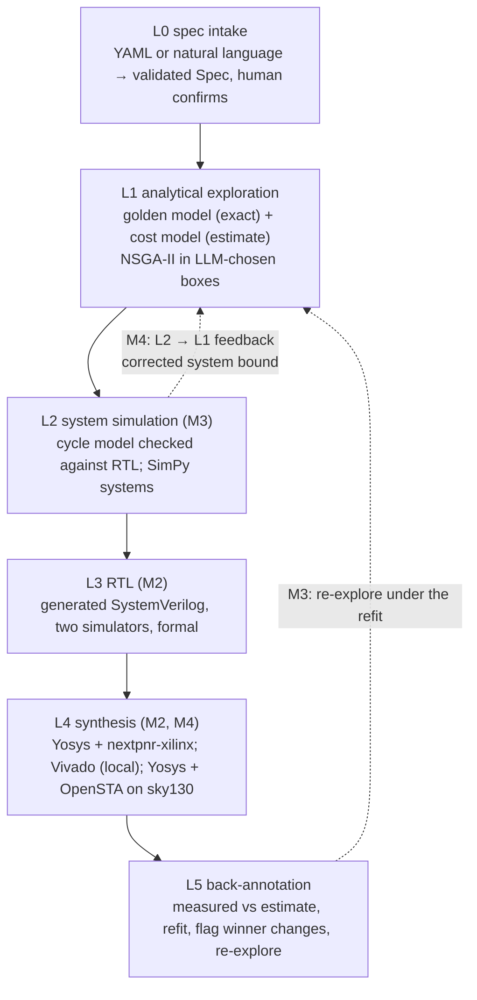

# HW Design Space Agent: final technical report (M1–M4)

<!-- sources: eval/results.md docs/writeup_facts.json -->

This is the project's closing report. It is built from the data committed in this
repository; `tests/test_writeup.py` checks that every number below appears, at the printed
precision, in the source files named under each heading. Where a section reports a loss, the
loss comes first.

## The question

<!-- sources: eval/results.md -->

Can a language model make hardware design-space exploration better, if it is never allowed to
produce a number? The running problem is a CORDIC sin/cos unit with four architecture families
(`iterative`, `unrolled_k`, `pipelined`, `pipelined_m`) and numeric knobs (data width,
iterations, angle-path width, guard bits, rounding, and the unroll or pipelining factor):
635,040 designs, small enough to enumerate, so every method can be scored against the exact
answer. A spec gives constraints (throughput, accuracy, from M3 system timing), one to three
objectives, a selection rule and a budget of 400 evaluations.

The rule held from the first commit to the last: **the LLM is never the optimiser and never
produces a PPA, accuracy or system-level number.** It plays the architect: it reads the spec,
picks families and ranges from a fixed registry, reads code-written summaries, and takes one
of a few typed decisions (refine, widen, add a family, map the front, declare infeasible,
stop). Optuna's NSGA-II searches inside its boxes; a bit-accurate golden model gives exact
accuracy; cost models give estimates; synthesis gives measurements; simulation gives system
metrics. Every number carries its provenance: *exact*, *estimate*, *measured (tool, version)*
or *simulated (model, version)*. The structured-output schemas have no field where a number
about a design could go.

Two scores recur. **HV fraction**: the hypervolume of the feasible designs a run found over
the true hypervolume of the exhaustive grid. **Selection regret**: how much worse the design
the run finally selects is than the true optimum on the spec's selection metric. Baselines are
NSGA-II and random search over the whole space with the same budget and the same evaluation
function.

## The ladder

<!-- sources: eval/results.md docs/writeup_facts.json eval/data/asic_calibration.md eval/data/l3_verification.csv -->

Each rung is code; the LLM sits only in the L1 loop. The ladder was built bottom-up in
evidence: the golden model is bit-exact against the reference RTL on all 65,536 input angles
of the reference configuration; the generated RTL matched the golden model in
47 configurations across two simulators (94 runs, 0 mismatches) and at gate level
(22 runs, 0 mismatches), with 7 of 7 formal proofs; L4 has 39 open-source FPGA points,
14 Vivado designs and, in M4, 57 ASIC calibration points plus 9 held-out ones.

## Milestone 1: the architect is a good selector and a bad mapper

<!-- sources: eval/results.md -->

**Loss first.** The M1 agent mapped the Pareto front far worse than plain NSGA-II on two of
three feasible specs: its HV fraction relative to NSGA-II was 0.32, 0.87 and 0.46 on
`dds_250msps` and 0.23, 0.22 and 0.18 on `low_area_control` for Sonnet 5.5, DeepSeek V4.1 Flash
and Qwen3.8-27B (reasoning off). It dived at the corner the selection rule picks and the 1%
hypervolume-gain rule then stopped it with a narrow front.

**What worked.** It selected better. Mean selection regret was below NSGA-II's on every model
and spec except one (Qwen on `low_area_control`, +12.2% against NSGA-II's +8.0%), and every
model declared the infeasible 400 MSPS spec infeasible itself in every run, using 100–200
evaluations where the baselines spend all 400 and simply find nothing. The cost model behind
all of this was weak by construction: five constants solved from two Vivado anchors.

## Milestone 2: climbing the ladder, and fixing the mapper in code

<!-- sources: eval/results.md eval/data/l5_refit_vivado-2025.2.md -->

**The levers.** M2 added deterministic whole-curve levers: a 40% reserve the LLM's own rounds
may not spend once something is feasible, a front-mapping round that code runs with whatever
is left, and a `map_front` decision the LLM may choose. They were tuned offline by replaying
the recorded M1 decisions, without spending anything. Live, the front-mapping gap closed:
agent HV relative to NSGA-II went to 1.02, 1.08 and 1.09 on `dds_250msps` and 0.97, 1.02 and
0.99 on `low_area_control`.

**Losses.** The selection lead mostly survived but not everywhere: DeepSeek's regret rose on
`dds_250msps` (+2.2% to +7.6%) and `low_area_control` (+1.6% to +5.1%), and Qwen on
`high_precision` reached +17.5% ± 27.2 on the strength of one seed whose first box was too
narrow to reach the accuracy target; the front-mapping round then never revisited that family.

**The measurements.** The open-source flow (Yosys 0.68 + nextpnr-xilinx on the anchors' part)
and, later, Vivado 2025.2 on 14 generated designs showed what the two-anchor model gets wrong.
Its known biases against Vivado are `pipelined` Fmax low by 15–17%, `iterative` Fmax high by
14–15%, and `unrolled_k` LUTs low by 37–40% at k = 3–4. A refit on 51 points was no better on
unseen Vivado points than the untouched M1 model, so the default never changed, and no spec's
ground-truth winner moved under the refit.

## Milestone 3: the design in a system, and an LLM outer loop that gained nothing

<!-- sources: eval/results.md docs/writeup_facts.json -->

**L2.** A cycle-accurate model of each family's interface contract matched the generated RTL
on 48/48 bursty traces (28,424 clock edges). SimPy models put the unit in a DDS, a control loop
and a bursty stream. On `multiaxis_control` only the simulation finds the winner: 53,667
designs pass the L1 bound, 51,244 the simulation, and the bound's winner misses the batch
deadline. On `bursty_offload` a peak-rate floor would have done as well, and the DDS spec
reduced to the throughput-only view. In the live runs L2 changed the L1 selection in 0 of 30
structured runs.

**The campaign agent (loss).** An outer agent on LangChain Deep Agents could call the
structured graph, single NSGA-II studies, the L2–L5 rungs and a memory. In 52 of 65 campaigns
its plan came down to one 400-evaluation call to the structured graph, and it cost 1.44 (Qwen),
1.62 (DeepSeek) and 2.25 (Sonnet) times as much per spec. Qwen failed 4 of 30 campaigns by
looping on the ladder tools. Its free-text notes to the inner architect narrowed the first box
in the worst run. Memory on vs off showed no benefit at three seeds. The campaign layer stayed
experimental and off by default.

## Milestone 4: a second target, a fleet, and feedback from L2 to L1

### An ASIC target on sky130

<!-- sources: eval/data/asic_calibration.md eval/data/asic_synthesis.csv eval/data/ground_truth_m4.json eval/results.md docs/writeup_facts.json -->

**The flow.** The same generated RTL goes through Yosys 0.33 and OpenSTA 3.1.0 against the
`sky130_fd_sc_hd` library at its typical corner (25 °C, 1.80 V), with a 10 ns clock:
cell area, flip-flops, the register-to-register path with the library's wire-load model, and
vectorless power. There is no placement: these are post-synthesis numbers, the ASIC
counterpart of the Vivado anchors, not of nextpnr's routed timing. OpenROAD could be installed
only through a commercial conda channel and needs a per-design floorplan and power grid, so
place and route stayed out of scope.

**The model.** The FPGA model's structural counts, re-weighted for standard cells and fitted
to 57 synthesised designs. Leave-one-out RMS error: area 8.7%, flip-flops 4.6%, Fmax 10.6%,
power against OpenSTA 5.8%; per family the worst is `unrolled_k` (area 12.8%, Fmax 12.5%).
One adder constant for every family fitted badly (14.8% on area); the FSM families needed
their own. The fitted adder delay is linear in width, about 0.29 ns per bit: Yosys's default
adder mapping ripples, which makes chained rotations expensive on this target.

**Does the family ranking differ from the FPGA? No.** Three ASIC specs, each with an FPGA twin
(the same constraints with area in LUTs + FFs, on the FPGA ground truth), rank the families in
the same order on both targets. What moves is the best configuration inside a family. At
50 MSPS the ASIC winner is `pipelined_m` with m=3 where the FPGA twin's is m=7; under the
0.5 µs batch deadline of `asic_multiaxis_control` it is m=2 where the FPGA's is m=5. The slow
ripple adders force shallower pipelining. The gaps shrink too: `pipelined` costs 4.17× the
`iterative` winner's area on `asic_low_area` and 4.99× its LUT+FF on the FPGA twin. Measured
directly, `pipelined` is 4.77× `iterative` in cell area at the anchors' W=16, N=14.

**L2 carried over unchanged** (it reads only the contract and Fmax) and on
`asic_multiaxis_control` it changes the winner: 8,533 designs pass the bound, 7,898 the
simulation.

### The held-out check: where the ASIC model is wrong

<!-- sources: eval/results.md eval/data/asic_validation.csv -->

**Loss first.** Nine ground-truth designs that the fit never saw (each spec's per-family optima,
the FPGA twins' optima, the L1-bound pick) were synthesised. Area is within 5% on all nine; Fmax
is not, from −14.9% to +39.6%, the worst an `unrolled_k` design. Two consequences. The FPGA
twin's m=7 winner for `asic_power_50msps` runs at 26.7 MHz on sky130 and cannot make 50 MSPS.
And the model's winner for `asic_multiaxis_control` measures 72.2 MHz against an estimate of
82.5 and then misses its deadline; of the nine, only plain `pipelined` W=17, N=14 (119.1 MHz)
meets that spec with measured numbers. The ASIC back-annotation node flags exactly this case.
It does not re-explore, because the default ASIC model is already the fit to every measurement.

### ASIC specs: the structured graph against the baselines

<!-- sources: eval/results.md -->

Five seeds of the structured graph per model on the three ASIC specs, against NSGA-II and
random search with the same budget (all scored on the ASIC ground truth, the system spec on
simulated feasibility). Every selected design met its spec (15/15 per model).

| spec | NSGA-II regret | Sonnet 5.5 | DeepSeek V4.1 Flash | Qwen3.8-27B |
|---|---|---|---|---|
| `asic_low_area` | +6.1% | +0.8% | +4.7% | +10.6% |
| `asic_power_50msps` | +54.0% | +3.5% | +15.6% | +10.1% |
| `asic_multiaxis_control` | +23.4% | +17.9% | +25.1% | +21.6% |

The M2 pattern carries to the new target where the selection rule has a corner to aim at:
on the power-driven spec every model's regret is a fraction of NSGA-II's (+54.0% ± 36.1):
the architects narrow onto the pipelining depth that the selection rule rewards, where
NSGA-II's union search keeps sampling every family. HV is at NSGA-II's level, not above it
(0.754–0.794 against 0.812 on `asic_power_50msps`). **Loss:** on `asic_multiaxis_control`
nobody gets close: NSGA-II and the three models all land 17.9–25.1% above the true winner,
whose trick (two more iterations for a narrower angle path and a faster clock) sits in a
corner the bound hides. L2 changed the L1 pick in 2 Sonnet runs.

### The fleet

<!-- sources: eval/results.md docs/writeup_facts.json -->

M3's lesson was that an LLM in the outer loop adds cost and loops without adding search. M4
tried the opposite: several structured graphs in parallel with code deciding everything
between them. Two members, one per contract class (FSM families and pipelined families), each
an unmodified structured graph restricted to its families. Half the budget is split equally;
code computes per-family facts from a shared LangGraph Store and gives the other half to the
members in proportion to their share of the merged Pareto front; code merges, selects and runs
L2 once. No LLM-written text reaches the store or another member. No LLM coordinator was built:
the coordinator's decisions are arithmetic over numbers code already has, and M3 showed what
an LLM in that seat costs.

**The A/B** (same five specs, three ASIC and two FPGA, seeds 0–4, 400 L1 evaluations for
both arms, every run started alone so its wall-clock is its own; Sonnet's fleet arm on
`asic_multiaxis_control` only, for the spend cap):

| model | arm | runs | HV fraction | regret | cost / run | wall / run |
|---|---|---|---|---|---|---|
| Qwen3.8-27B | single | 25 | 0.829 ± 0.071 | +14.8% ± 11.4 | $0.0090 | 57 s |
| | fleet | 25 | 0.796 ± 0.099 | +11.7% ± 19.9 | $0.0127 | 171 s |
| DeepSeek V4.1 Flash | single | 25 | 0.870 ± 0.061 | +12.1% ± 11.9 | $0.0167 | 153 s |
| | fleet | 25 | 0.834 ± 0.080 | +15.8% ± 21.5 | $0.0257 | 229 s |
| Sonnet 5.5 | single | 5 | 0.820 ± 0.069 | +17.9% ± 3.2 | $0.0931 | 41 s |
| | fleet | 5 | 0.794 ± 0.051 | +19.9% ± 3.6 | $0.1488 | 49 s |

**The single graph wins.** The fleet maps a smaller share of the front for every model, costs
1.4 to 1.6 times as much per spec, and is slower even though its members run in parallel
(two phases, each waiting for its slowest member). Regret is mixed: lower for Qwen, higher for
DeepSeek and Sonnet, and the spreads overlap. No run failed to produce a spec-meeting design
in either arm; the fleet had more failed (retried) LLM calls: 17 against 3 over the Qwen and
DeepSeek arms.

What the records show, and what they do not. The fleet spends more of its budget on the
FSM families than a single graph does: on average 180 of 400 evaluations for the Qwen and
DeepSeek fleets against 128 (Qwen) and 166 (DeepSeek) for their single graphs, and 100 against
18 for Sonnet on `asic_multiaxis_control`, where no FSM design can meet the deadline. Its FSM
member often proves that the hard way (Qwen's declared its families infeasible 16 times in 25
runs), and phase 2 then went entirely to the pipelined member in 14 (Qwen) and 15 (DeepSeek)
of 25 runs. The HV loss is largest on the system specs (`multiaxis_control`: 0.840 to 0.734
for Qwen). A fixed split by contract class is a worse allocation than the architect's own
early choice of families plus one front-mapping round over all of them; smaller studies per
member (fewer NSGA-II generations each) may also contribute. These are readings of the
records, not tested causes.

**Throughput, measured** (designs evaluated per hour of wall-clock, one run at a time):
single 25,212 (Qwen), 9,410 (DeepSeek), 35,002 (Sonnet, one spec); fleet 8,400, 6,292 and 29,256. Cost
per spec is $0.0090, $0.0167 and $0.0931 for the single graph. Projected, not run: one such
machine running Qwen single-graph runs back to back would evaluate 605,084 designs and close
1513 specs a day for $13.64, if nothing else changed.

### L2 → L1 feedback

<!-- sources: eval/data/l2_feedback_m4.json docs/writeup_facts.json -->

When L2 rejects every L1-feasible design of a run, the run spent its budget where the bound
was wrong. The feedback measures the bound's error on every simulated design, fits a monotone
correction in the device's utilisation per contract class (still optimistic at every design L2
has seen), and re-explores with a separate budget of 3 × 60 evaluations under the corrected
bound.

It never fires on the committed specs: 0 of 92 recorded searches (M3 structured runs rebuilt
from their archived evaluations, M3 campaign pools, NSGA-II and random on every system spec)
and 0 of 50 live M4 runs found an L1-feasible set that L2 rejected whole. A spec was
constructed where it does: bursts of 32 requests at 130 MS/s with p99 latency ≤ 0.4 µs.
61,461 designs pass the bound and 447 pass the simulation, all plain `pipelined`; the cheaper
`pipelined_m` designs the area objective prefers pass the bound and queue in simulation. It
fired in 6 of 15 searches of 400 evaluations (NSGA-II, random and the rule-based architect),
and the correction recovered a passing design in 6 of 6 (regret +19.5% ± 12.1 against the
true winner). The ablation, the same re-exploration budget screened with the uncorrected bound,
recovered in 2 of 6: it is the correction, not the extra evaluations.

## The A/Bs, together

<!-- sources: eval/results.md docs/writeup_facts.json -->

| A/B | milestone | result |
|---|---|---|
| LLM architect vs NSGA-II and random, 400 evaluations | M1 | better selection (lower regret on 8 of 9 model × spec cells), much worse front mapping |
| the same, with code levers for the front | M2 | front mapping at parity (0.97–1.09 of NSGA-II's HV); the selection lead mostly kept |
| structured graph vs an LLM campaign agent on top | M3 | no gain; 1.44–2.25× the cost; Qwen failed 4 of 30 |
| memory on vs off (campaign agent) | M3 | no benefit visible at three seeds |
| structured graph vs a code-orchestrated fleet, equal budget | M4 | the single graph has higher HV for every model; regret mixed; the fleet costs 1.4–1.6× |
| L2 → L1 feedback, corrected vs uncorrected bound, equal extra budget | M4 | recovers 6 of 6 vs 2 of 6 on the constructed spec; never needed on the committed specs |

Across four milestones the gains came from code: the levers, the L2 shortlist, the correction
of the bound. The LLM's contribution that held up in every A/B is the early, typed judgement of
which families can meet a spec and where its selection corner is. Every attempt to give the
LLM a bigger role (the campaign agent) or to replace that judgement with a fixed split (the
fleet) lost.

Provider drift is real and large. Qwen on `low_area_control`, through a graph that replays its
M2 runs identically, had +3.7% mean regret in M2 and +22.8% in this session's single arm;
comparisons are therefore made only between arms run in the same session.

## Limitations

<!-- sources: eval/results.md eval/data/asic_calibration.md -->

* **Every ground truth is a model's.** The FPGA one is the two-anchor M1 model, kept fixed so
  that four milestones are scored on the same answer; the ASIC one is the fitted sky130 model.
  The measurements say how far each is off (FPGA Fmax by up to 17% against Vivado; ASIC Fmax
  10.6% leave-one-out and up to +39.6% on a held-out design), and specs whose winner sits
  closer to a constraint than that are only as settled as a measurement makes them.
* **Post-synthesis timing on the ASIC**, one corner, a wire-load model, no buffering or
  sizing, no clock tree, no place and route; ripple adders from Yosys's default mapping. A
  commercial flow would change the absolute numbers and could change the within-family
  optimum again.
* **Power is a toggle-rate model everywhere.** On the FPGA nothing was measured (the
  `report_power` export is ready); on the ASIC the index reproduces OpenSTA's vectorless power,
  which assumes uniform activity.
* **Small samples.** Five seeds per model and spec, two or three models, a handful of specs.
  Day-to-day provider drift is visible in the data (below), so arms are compared only within
  one session.
* **Single-lane designs only**; the 400 MSPS spec is infeasible by construction of the registry.
* **The L2 → L1 feedback never fired on the committed specs**; its evidence is one
  constructed spec and offline searches.

## What I would do next

<!-- sources: eval/results.md -->

1. Run the two Vivado exports locally: `high_precision` at a 20 ns constraint settles the
   post-synthesis view of m=8 and with it the deferred per-family-class path factor; the
   `report_power` run is the first measured FPGA power.
2. Place and route on sky130 (OpenROAD) for the held-out designs, to see whether the ASIC
   model's Fmax error is the wire-load model or the structure.
3. Refit the ASIC model with the held-out points and an `unrolled_k` chain term, and add an
   ASIC L5 loop that re-explores under it, as the FPGA path does.
4. Multi-lane and polyphase families, so that the 400 MSPS spec has an answer.
5. Treat provider drift as a first-class measurement: pin model snapshots where the provider
   allows it, and re-run a fixed reference set each session before comparing arms.
